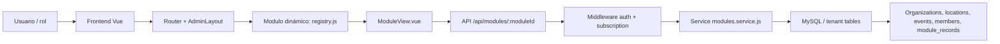

# Análisis global de la estructura por módulos del proyecto Holi Places

## 1. Visión general

El proyecto está organizado como un monorepo compuesto por dos capas principales:

- Frontend Vue 3 + Vite + Router + Pinia
- Backend Express + MySQL

La organización funcional no está dividida por pantallas aisladas, sino por módulos de negocio reutilizables. La lógica central se apoya en tres principios:

1. Un registro central de módulos en el frontend.
2. Una API genérica para CRUD de módulos en el backend.
3. Un modelo multi-tenant con datos separados por organización.

Esto genera una base arquitectónica escalable, donde cada módulo comparte la misma estructura global de permisos, validaciones y presentación.

---

## 2. Estructura general del proyecto

### Frontend

La capa de interfaz está organizada por responsabilidades funcionales:

- src/modules: registro central de módulos operativos.
- src/router: rutas principales, redirecciones y validación de acceso.
- src/views: pantallas concretas del producto (dashboard, billing, community, module, etc.).
- src/layouts: shell de administración.
- src/components: componentes reutilizables y vistas específicas.
- src/stores: estado global del usuario y la sesión.
- src/services: clientes HTTP para consumir la API.

La clave visual es que la navegación de módulos se genera de manera dinámica desde un array central. Esto reduce duplicación y permite que cualquier nuevo módulo siga el mismo patrón visual y operativo.

### Backend

La capa de negocio mantiene una separación clara:

- app.js: montaje de rutas, middleware global y configuración de CORS/helmet.
- routes/: endpoints HTTP por área funcional.
- controllers/: orquestación de requests/responses.
- services/: lógica de negocio y acceso a datos.
- middleware/: autenticación, roles, tenant, suscripción activa.
- db/: esquema y migración de tablas MySQL.

El backend no expone una arquitectura por entidad aislada, sino por dominio funcional. Cada área (auth, billing, dashboard, modules, organizations, public) tiene un flujo claro basado en servicios y middlewares.

---

## 3. Patrón global de organización por módulo

El proyecto define 11 módulos canónicos funcionales con nombres estandarizados:

- events
- reservations
- members
- groups
- attendance
- locations
- resources
- communications
- reports
- subscription
- settings

La definición real de estos módulos aparece en la colección de `registry.js` y luego se consumen desde `router/index.js` y `views/ModuleView.vue`.

Esto permite que el sistema tenga una lógica común:

- un solo componente visual de detalle por módulo
- mismo flujo CRUD para todos los casos
- misma validación de acceso y suscripción
- mismo modelo de persistencia por organización

La estructura general es:

- cada módulo tiene un identificador único (`moduleId`)
- la capa de frontend lo renderiza como ruta y vista compartida
- la API lo procesa como recurso dinámico (`/api/modules/:moduleId`)
- la base de datos guarda registros con `module_id` y `organization_id`
- los permisos se evaluan por rol y por módulo

---

## 4. Análisis de cada módulo funcional

### 4.1 Agenda: calendario, reuniones y eventos

La agenda es un único módulo canónico (`events`) que concentra calendario, reuniones, cultos y eventos. Antes existían tres entradas (`calendar`, `meetings` y `events`) que consultaban y modificaban la misma tabla `events`, con el mismo formulario y sin distinguir tipos; esa duplicación se consolidó para evitar pantallas equivalentes.

Las rutas antiguas `/calendar` y `/meetings` se conservan como redirecciones a `/events`, y el backend acepta esos IDs como alias para clientes antiguos. Los planes que ya habilitaban cualquiera de esos nombres siguen habilitando la agenda canónica.

Estructura lógica:

- se leen desde `events` y se agrupan por fechas
- cada evento incluye nombre, descripción, fecha, duración, status y location_id
- se puede asignar una sede a cada evento
- `assignEventToLocation` valida que el evento y la sede pertenezcan a la misma organización

Su valor principal es mantener una agenda central de la congregación, con una referencia clara a sedes y personas. El registro y resumen de asistencia permanece en el módulo especializado de Asistencia.

### 4.2 Reservations

Este módulo gestionará reservas de espacios físicos.

- se modela con `space_reservations`
- se valida conflicto de horario por sede
- requiere datos de responsable, fechas, título y notas
- una reserva no puede solaparse con otra en la misma ubicación

Tiene una lógica muy sólida porque combina validación de negocio + transacción SQL. Esto lo convierte en un módulo de operación crítica, porque impacta directamente la disponibilidad del espacio.

### 4.3 Members

Módulo de personas o miembros de la comunidad.

- usa la tabla `members`
- se mantiene el registro básico: nombre, apellido, correo, estado
- es un módulo de mantenimiento de la base de contactos operativos

Su estructura es simple, pero es la base del resto del ecosistema, ya que conecta con reservas, asistencias y participación comunitaria.

### 4.4 Groups

Este módulo representa agrupaciones o comunidades internas.

- se guarda en `module_records` con `module_id = 'groups'`
- soporta título, estado, descripción, detalle y fecha
- puede ser público o no, según configuración

Su lógica funcional es más flexible que los módulos de calendario, porque el contenido puede variar según la necesidad concreta de cada congregación.

### 4.5 Attendance

Módulo de presencia y asistencia.

- se almacena como registro genérico, pero con un tratamiento especializado en la vista
- se usa para reuniones, servicios y sesiones de seguimiento
- la UI calcula totales, pendientes y asistentes según el texto del detalle

Desde el punto de vista arquitectónico, esta es una buena muestra del patrón del proyecto: un módulo con lógica semántica particular, pero almacenado con la estructura general del sistema.

### 4.6 Locations

Es el módulo de sedes y ubicaciones físicas.

- tabla `locations`
- guarda nombre, ciudad, dirección, latitud y longitud
- se usa para mapas, eventos y reservas

Este módulo es esencial porque conecta la operativa con la geografía. La vista lo renderiza como mapa y además expone los eventos y reservas asociados, lo que lo convierte en una pieza central para la organización territorial de la congregación.

### 4.7 Resources

Este módulo representa inventario y recursos físicos.

- equipo, materiales, muebles, tecnologías o útiles de operación
- se guarda en `module_records`
- permite disponibilidad, ubicación y condición del recurso

Es un módulo de control interno con gran potencial para la operación real de la comunidad.

### 4.8 Communications

Módulo para avisos, mensajes y comunicaciones internas o públicas.

- contenido genérico almacenado en `module_records`
- ideal para mensajes institucionales, recordatorios, boletines o comunicados

Se considera un módulo clave para la relación con la comunidad y la coordinación de actividades.

### 4.9 Reports

Módulo para informes y resultados.

- guardado como `module_records`
- permite resúmenes, hallazgos, resultados y revisiones
- ideal para seguimiento mensual o semestral

Es un módulo analítico y de trazabilidad. Su objetivo principal es convertir la actividad operativa en información útil para decisiones y seguimiento.

### 4.10 Subscription

Este módulo es de carácter comercial y de acceso.

- está ligado a Stripe y a la seguridad del SaaS
- la suscripción activa determina si los módulos quedan habilitados
- la capa de middleware impide acceso a las operaciones si la organización no tiene plan activo

Es el único módulo con control estrictamente comercial, y su presencia es lo que hace que el proyecto sea un sistema SaaS multi-tenant y no solo un gestor de comunidad.

### 4.11 Settings

Módulo de preferencias y configuraciones operativas.

- modelo genérico, pero orientado a valores de funcionamiento
- puede representar horarios, reglas, políticas, parámetros o preferencias de la congregación

Su valor es estructural: deja la organización configurable sin requerir una nueva tabla por cada configuración.

---

## 5. Módulos transversales del sistema

Además de los 11 módulos funcionales canónicos, existen áreas transversales que estructuran todo el producto:

### Auth

- login, sesión, logout
- JWT firmado en cookies
- validación de usuario y tenant
- permisos por rol: superadmin, admin, operator

### Dashboard

- consulta el estado real de la organización
- muestra el estado de la suscripción
- habilita el acceso visual según la condición del pago
- ayuda a la navegación general y a la validación del tenant activo

### Billing

- consulta y manejo de pago
- integraciones Stripe
- checkout, webhook, verificación de suscripción
- estado de cuenta y pagos pendientes

### Community

- vista pública para visitantes y comunidad general
- muestra contenido publicado autorizado
- se limita a contenido no sensible y vigente

### Organizations, Team, Plans

- gestión de organizaciones y usuarios
- administración SaaS para superadmin
- configuración de planes y entitlements

Estas capas no son módulos operativos del calendario o de la comunidad; son capas de control institucional y de plataforma.

---

## 6. Patrón de permisos y tenant

La seguridad de la solución se centra en tres capas:

1. Autenticación con cookie y sesión
2. Validación por rol
3. Aislamiento por organización

El middleware `auth.middleware.js` hace lo siguiente:

- verifica que la sesión sea válida
- determina la organización actual según el rol
- limita acciones por rol (`superadmin`, `admin`, `operator`)
- evita que un usuario acceda a otra organización
- valida que la suscripción esté activa antes de abrir módulos comerciales o de operación

Esto produce una arquitectura de seguridad muy clara: no basta con estar logueado, también hay que estar autorizado por rol y por tenant.

---

## 7. Patrón de base de datos y persistencia

La base de datos está diseñada para soportar un modelo multi-tenant híbrido:

- tablas globales: organizations, users, subscriptions, saas_plans, billing_webhook_events
- tablas operativas por organización: locations, members, events, reservations, module_records, community_posts

La función `ensureTenantColumns()` añade `organization_id` a las tablas claves y hace que cada registro quede asociado explícitamente a una organización. Esto genera una estructura ordenada para una SaaS con múltiples congregaciones y un mismo backend.

La pieza más importante es `module_records`, porque permite un patrón universal de almacenamiento para casi todos los módulos generados por contenido. La diferencia entre módulos no es tanto la tabla sino el `module_id` y el contenido del registro.

---

## 8. Qué estructura genera esta arquitectura globalmente

La arquitectura global genera una solución con estas características:

### a) Modularidad funcional

Cada módulo se comporta de manera similar, lo que ayuda a escalar sin duplicar lógica.

### b) Multi-tenancy real

Todo se organiza bajo la idea de que cada congregación es un tenant con su propia base de operaciones, datos y suscripción.

### c) Transparencia operativa

Los módulos no están hechos como pantallas sueltas, sino como piezas del mismo sistema administrativo.

### d) Flexibilidad de contenidos

Los módulos dinámicos permiten adaptarse a diferentes tipos de comunidad sin reescribir la aplicación completa.

### e) Control de negocio

La autorización, la suscripción y la validación de horario generan una capa de reglas que protegen la integridad del sistema.

---

## 9. Fortalezas del diseño

- Reutilización del mismo patrón CRUD para casi todos los módulos.
- Consistencia visual y funcional entre pantallas.
- Separación clara entre front, back y persistencia.
- Seguridad sólida por roles y organización.
- Escalabilidad para agregar nuevos módulos con poco esfuerzo.
- Modelado adecuado para SaaS y gestión de comunidades.

---

## 10. Riesgos y observaciones

Aunque la arquitectura es ordenada, hay algunos puntos a revisar:

- la lógica es muy dinámica y depende de convenciones estrictas de `module_id`
- la composición de módulos genéricos puede dificultar la trazabilidad de reglas muy específicas
- hace falta mantener una disciplina fuerte en la nomenclatura de campos para no desordenar la capa de datos
- el sistema se apoya mucho en una convención de registro uniforme, por lo que un cambio incorrecto puede afectar muchos módulos a la vez

En otras palabras, el diseño es muy eficiente para crecer, pero exige control disciplinado en las convenciones del dominio.

---

## 11. Conclusión

La organización global del proyecto está construida alrededor de un modelo de módulos funcionales, un backend multi-tenant y una interfaz dinámica. En lugar de crear un sistema de pantallas aisladas, el proyecto genera una estructura de negocio unificada donde cada área comparte la misma lógica, permisos, modelo de persistencia y flujo de validación.

El resultado es una arquitectura que se siente ordenada, reutilizable y preparada para crecimiento. El punto más fuerte es la combinación de:

- modularidad por negocio
- control por roles y organización
- persistencia unificada con tenant
- UI dinámica basada en catálogo de módulos

Esto hace que Holi Places se estructure como una aplicación SaaS de gestión comunitaria con clara separación entre operación, administración y comunidad pública.
