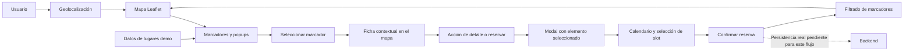

# Análisis técnico de `MapExample5.vue`

## Propósito de este documento

Este análisis es una especificación de transferencia para implementar en el proyecto independiente Holi Places la experiencia de mapa y reserva que sirve de referencia en el Laravel anterior. Describe el comportamiento comprobable del componente fuente, separa lo que existe de lo que aún es una propuesta y define una arquitectura de destino Vue 3 + Express. No implica que los endpoints de negocio ya estén implementados.

## Fuentes revisadas

- `scaling-places-octos/resources/js/components/MapExample5.vue`
- `scaling-places-octos/resources/js/components/ControlsV2.vue`
- `scaling-places-octos/resources/js/components/ResetsControls.vue`
- `scaling-places-octos/resources/js/components/ModalOneSection.vue`
- `scaling-places-octos/resources/js/components/Calendar.vue`
- `scaling-places-octos/routes/api.php`
- Especificación funcional `scaling-places-octos/Frontend_Vue3_Sistema_Administracion_Religiosa.md`
- `holi_frontend/src/views/ModuleView.vue` y `holi_frontend/src/services/moduleService.js`
- Rutas, servicios y esquema MySQL de `holi_backend/src/`

## Objetivo funcional

Permitir que una persona explore visualmente sedes, servicios o productos geolocalizados; seleccione un marcador directamente sobre el mapa; consulte información contextual del elemento seleccionado; y desde esa ficha abra una interacción posterior, como un modal de detalle/reserva, un calendario de fechas y horarios y, finalmente, la confirmación de una acción. El mapa es la superficie principal de exploración y no una imagen decorativa ni una lista de productos.

El flujo también debe permitir centrar el mapa en la ubicación actual o en una zona elegida, filtrar los marcadores por distancia y tipo de servicio, y conservar el contexto del elemento seleccionado mientras la persona navega por el modal/calendario.

La experiencia combina dos contextos que conviene mantener distinguibles durante la implementación:

- **Descubrimiento público:** mapa, ubicación aproximada, filtros y detalle de sedes/servicios disponibles.
- **Administración:** configuración de sedes, servicios, horarios, recursos y gestión de reservaciones. Es parte de la plataforma más amplia, pero no está implementada por `MapExample5.vue`.

## Comportamiento actual observado

1. En `created()`, `fetchLocations()` carga seis ubicaciones estáticas de ejemplo. Cada una tiene `id`, `name`, `latlng` (`[lat, lng]`), `serviceType`, `img`, `rating` y `ratingCount`. `fetchZones()` carga cuatro zonas estáticas; no consulta backend.
2. En `mounted()`, el componente solicita geolocalización para añadir la zona `Mi Ubicacion`. `initMap()` solicita geolocalización otra vez; cuando tiene éxito, crea el mapa Leaflet con zoom 13, añade el mosaico OpenStreetMap, el marcador del usuario, control de escala, controles personalizados y marcadores de lugares.
3. Cada marcador es una entrada interactiva. Su popup actúa como ficha contextual superpuesta al mapa y muestra imagen, nombre, tipo de servicio, rating, estrellas, cantidad de reseñas y CTA `Reservar`.
4. El marcador se abre al hacer clic y también al pasar el cursor (`mouseover`). La intención es que se pueda explorar la ficha sin abandonar el mapa. Al seleccionar el punto, el mapa conserva/establece la zona usada como centro de búsqueda.
5. Al pulsar `Reservar` dentro de la ficha se pretende abrir `ModalOneSection` con el nombre, tipo de servicio e ID del lugar. El modal conserva esa identidad como contexto y contiene `Calendar.vue`.
6. El calendario permite navegar entre meses, elegir una fecha no pasada y muestra horas para algunas fechas. Al elegir una hora, emite la fecha y hora al modal; el modal presenta la selección. El botón final `Reservar` existe visualmente, pero hoy no realiza la persistencia ni confirma al servidor.
7. Los controles personalizados del mapa abren `ControlsV2` y `ResetsControls`. La intención de `ControlsV2` es seleccionar zona, tipo de servicio y distancia; si esos valores cambian, el padre filtra los marcadores. Sin embargo, los controles para zona, tipo y distancia están comentados en la versión leída y queda visible un campo de precio deshabilitado.
8. `ResetsControls` pretende ofrecer acciones de limpiar/restablecer y centrar en ubicación. Los iconos no tienen handlers ni emiten eventos, por lo que actualmente son UI sin comportamiento conectado.

### Flujos que debe soportar la implementación

1. **Explorar:** cargar mapa y elementos; mostrar todos los marcadores disponibles y un indicador distinto para la ubicación actual.
2. **Inspeccionar un punto:** clic/tap en un marcador selecciona un elemento, actualiza su estado visual, centra o enfoca el mapa sin perder contexto y presenta una ficha con sus datos y acciones.
3. **Ver más / iniciar reserva:** la acción de la ficha abre un modal/drawer con el ID y el contenido del elemento seleccionado; cerrar el overlay vuelve al mismo mapa y selección.
4. **Elegir disponibilidad:** navegar calendario, elegir fecha y luego un slot disponible. Mostrar claramente fecha, hora, zona horaria y elemento reservado; distinguir carga, error, sin slots y selección válida.
5. **Confirmar:** enviar la reserva al backend, mostrar progreso, éxito o conflicto. No dar por reservada una fecha solo por seleccionarla en el calendario.
6. **Orientarse y filtrar:** centrar en ubicación propia, elegir zona manual, filtrar por radio/tipo, limpiar filtros y mantener controles táctiles accesibles en móvil.



## Estado real frente a lo propuesto

| Capacidad | En el componente de referencia | Estado para Holi Places |
|---|---|---|
| Mapa y teselas OpenStreetMap | Implementados con Leaflet | `holi_frontend` ya muestra un mapa administrativo de sedes desde la API |
| Lugares y zonas | `MapExample5` usa datos locales | MySQL contiene sedes con coordenadas y `GET /api/modules/locations` las entrega dentro del tenant; aún no expone categoría, imagen ni rating |
| Geolocalización | Navegador, duplicada durante el montaje | El mapa administrativo centra la primera sede; el flujo público necesita geolocalización tolerante a errores |
| Filtro por distancia y tipo | Lógica presente; UI de filtros deshabilitada/comentada en `ControlsV2` | Aún no aparece en el mapa administrativo actual |
| Calendario y horarios | Fechas de ejemplo de 2023 en memoria | No hay endpoint dedicado de disponibilidad por sede/servicio/fecha |
| Crear reservación | Ficha y modal/calendar permiten llegar a una selección, pero el CTA final no llama a una API | Holi Places persiste reservas administrativas manuales de espacios y rechaza solapamientos mediante `POST /api/modules/locations/:locationId/reservations`; aún no implementa la selección de disponibilidad pública por slot |
| Estado API y dashboard | No aplica | Express expone `GET /api/health`, `GET /api/dashboard`, `GET /api/modules/:moduleId` y mutaciones de reservas/asignación de eventos |

La vista administrativa de Sedes y la experiencia de descubrimiento interactiva de `MapExample5` son flujos distintos. La primera permite localizar una sede y administrar reservas manuales; todavía no sustituye la exploración pública con fichas contextuales, filtros por zona/radio, modal y calendario con disponibilidad. Los endpoints propuestos más adelante son contratos de diseño, salvo que se marquen como existentes.

## Arquitectura actual y límites

`MapExample5.vue` mezcla ciclo de vida, geolocalización, creación y destrucción implícita del mapa, estado, filtrado, generación de HTML para popups y apertura de modales. Mantiene un estilo Options API. Vue 3 puede ejecutar ese estilo, pero el proyecto objetivo ya está organizado como SPA Vue 3 con Router, Pinia y servicios separados. Además, `holi_frontend/src/views/ModuleView.vue` ya carga el módulo `locations` desde Express, crea un mapa Leaflet de administración y ofrece formularios para reservar una sede o reasignar un evento. La migración debe extraer capacidades de esa vista, no crear un segundo mapa administrativo desconectado.

### Dependencias y relaciones

- `leaflet`: motor de mapa y medición geográfica.
- `vue`: estado reactivo, ciclo de vida, refs y componentes.
- `ControlsV2.vue`: panel para filtros, actualmente con la UI de filtro comentada.
- `ResetsControls.vue`: presentación de botones de reset y centrado; actualmente no emite acciones hacia el mapa.
- `ModalOneSection.vue`: modal que integra `Calendar.vue`.
- `Calendar.vue`: calendario y lista de horarios estáticos; no consume disponibilidad del servidor.
- `holi_frontend/src/views/ModuleView.vue`: consumidor API actual de datos de módulos; dibuja el mapa administrativo de sedes, muestra reservas/eventos y envía la reserva manual.
- `holi_frontend/src/services/moduleService.js`: cliente de `GET /api/modules/:moduleId`, `POST /api/modules/locations/:locationId/reservations` y `PATCH /api/modules/events/:eventId/location`.
- `holi_backend/src/db/database.js`: esquema MySQL para organizaciones, usuarios, sedes, miembros, eventos, inscripciones, reservas de espacios y registros genéricos por módulo.
- `holi_backend/src/services/modules.service.js`: lectura de módulos, persistencia de reservas con validación de solapamiento y asignación de eventos a sedes.

### Defectos y riesgos que no se deben copiar

1. La geolocalización se solicita dos veces. Si el usuario deniega el permiso o el navegador no soporta geolocalización, no se llega a crear el mapa ni a mostrar lugares.
2. El watcher de `selectedDistance` llama a `filterLocations()` sin asegurar que exista `selectedLocation`; `filterLocations()` desreferencia `selectedLocation.latlng`.
3. La referencia `this.marker` no corresponde al marcador local creado por el `map()` de ubicaciones. La rama que intenta abrir ese marcador no es fiable.
4. Los listeners del popup buscan `.get-service-button` con `document.querySelector`, por lo que el primer botón coincidente puede no pertenecer al popup interactuado. Los eventos se vuelven a registrar en clic y hover.
5. El HTML del popup concatena campos del lugar. Si esos valores pasan a venir de usuarios/API, hay riesgo de inyección HTML. Preferir contenido DOM controlado o escapar cualquier texto no confiable.
6. `ControlsV2` declara como obligatorias `linkSelectedLocation`, `linkSelectedServiceType` y `linkSelectedDistance`, pero `MapExample5` solo le entrega `linkSelectedLocation` y `linkZones`; además el primero comienza como `null`. La UI que emitiría los filtros está comentada y solo queda un campo de precio deshabilitado.
7. Los botones de `ResetsControls.vue` no tienen handlers ni emiten eventos; abrir ese panel no reinicia filtros ni recentra el mapa.
8. `CustomButton.onRemove()` intenta quitar un listener usando `button`, variable que no está en su ámbito. Los controles Leaflet deben conservar la referencia al elemento o limpiar listeners mediante el ciclo de vida apropiado.
9. La reservación exige que `selectedLocation` tenga valor; esa ubicación se inicializa indirectamente al pasar por un marcador y no mediante una decisión visible y explícita de búsqueda.
10. El calendario contiene disponibilidad antigua hardcodeada. El botón `Reservar` del modal no envía la selección, no maneja carga/error y no persiste una reservación.
11. La conversión de coordenadas actual es un arreglo posicional `[lat, lng]`, fácil de invertir accidentalmente entre frontend, GeoJSON y base de datos.
12. Hay CSS global y medidas fijas de popups/controles que pueden afectar otras vistas y fallar en móvil.
13. El popup se abre también con `mouseover`, lo que puede interrumpir el mapa al recorrerlo y no define una interacción equivalente y estable en pantallas táctiles.
14. El CTA de reserva solo abre el modal cuando existe `selectedLocation`, pero esa variable representa el centro/zona de búsqueda y no el lugar clicado. El ID del lugar se captura dentro del listener HTML global; separar `selectedLocationId` del `searchCenter`.

## Arquitectura objetivo para el frontend

Ubicación del proyecto: `holi-places/holi_frontend/`.

```text
src/
├── modules/
│   └── booking-map/
│       ├── components/
│       │   ├── MapPage.vue
│       │   ├── MapCanvas.vue
│       │   ├── LocationMarker.vue
│       │   ├── MapFilterPanel.vue
│       │   ├── LocationPopup.vue
│       │   ├── LocationDetailsPanel.vue
│       │   ├── BookingDialog.vue
│       │   └── AvailabilityCalendar.vue
│       ├── composables/
│       │   ├── useLeafletMap.js
│       │   ├── useGeolocation.js
│       │   └── useLocationFilters.js
│       ├── services/
│       │   ├── locationsApi.js
│       │   ├── availabilityApi.js
│       │   └── reservationsApi.js
│       ├── stores/
│       │   └── bookingMap.js
│       └── index.js
├── services/
│   └── http.js
├── router/
└── main.js
```

### Responsabilidades

- **`MapPage.vue`:** coordina la página, carga lugares y traduce acciones de UI a acciones de store/servicios. No crea HTML Leaflet ni implementa la fórmula geográfica.
- **`MapCanvas.vue` + `useLeafletMap.js`:** crean el mapa una vez cuando el elemento DOM existe; reciben centro/zoom; exponen operaciones de centrar y sincronizan capas. Al desmontarse, llaman `map.remove()` y limpian eventos.
- **`useGeolocation.js`:** encapsula la API del navegador con estados `idle`, `loading`, `success`, `denied/error`; devuelve coordenadas `{ lat, lng }`. No bloquea la creación del mapa: hay un centro inicial configurable si no hay permiso.
- **`useLocationFilters.js`:** función pura para tipo y radio. Las distancias se expresan explícitamente en kilómetros en UI y se convierten a metros en un solo punto; no centra el mapa en cada cambio de filtro salvo acción explícita.
- **`LocationMarker.vue` / popup:** reciben datos normalizados; el popup emite `select`/`reserve` con `locationId`. Evitar selectores globales y evitar interpolar datos en HTML arbitrario.
- **`LocationDetailsPanel.vue`:** muestra la información contextual del marcador activo (nombre, categoría/servicio, imagen, rating y dirección/datos disponibles) y ofrece acciones claras. La ficha debe permanecer sincronizada con el punto seleccionado y no ser un popup HTML suelto sin estado Vue.
- **`MapFilterPanel.vue`:** controla los campos activos de zona, categoría y distancia y emite un único objeto de filtros. Incluye limpiar filtros y estado vacío.
- **`BookingDialog.vue` + `AvailabilityCalendar.vue`:** reciben el lugar/servicio activo por ID, solicitan slots al cambiar fecha, permiten elegir fecha/hora y muestran un resumen antes de confirmar. Separan consulta de disponibilidad del POST de reserva; soportan cerrar/regresar sin perder la selección y muestran errores/confirmación.
- **`MapControls.vue`:** agrupa acciones operativas del mapa: abrir filtros, recentrar en usuario, elegir zona/área, restablecer filtros y volver a la vista general. Cada control debe emitir una acción explícita y mostrar estado accesible.
- **`bookingMap` (Pinia):** mantiene entidades separadas para `searchCenter` (coordenada/zona usada para radio), `selectedLocationId` (marcador activo), `filters`, `visibleLocationIds`, `activeOverlay`/`bookingContext` y estados de carga/error por operación. Evita reutilizar `selectedLocation` para significados distintos.
- **Servicios API:** únicos responsables de HTTP; importan el Axios compartido, usan `VITE_API_URL` y retornan datos tipados/normalizados. Manejan errores en una convención uniforme.

## Arquitectura objetivo para el backend

Ubicación: `holi-places/holi_backend/`. Mantener Express independiente del frontend y agrupar cada dominio en router, controller, service y, cuando exista persistencia, repository/model.

```text
src/
├── app.js
├── server.js
├── routes/
│   ├── modules.routes.js
│   └── [rutas específicas del mapa por definir]
├── controllers/
├── services/
├── repositories/
├── validators/
├── middleware/
└── errors/
```

El árbol anterior describe una dirección modular propuesta, no la estructura exacta. Hoy `app.js` configura Helmet, CORS con credenciales, cookies, límites de payload, autenticación y errores; las reglas SQL viven en servicios. La API usa JWT en cookie `HttpOnly`, contraseñas bcrypt, límite de intentos de login y control de origen en escrituras. La autorización aplica superadmin global, admin por tenant y operador limitado a reservas/asistencia.

### Base existente en Holi Places

El backend usa MySQL (`mysql2/promise`) y carga registros de demostración repetibles al iniciar. El esquema incluye `organizations`, `users`, `locations`, `members`, `events`, `reservations` (inscripciones), `space_reservations`, `community_posts` y `module_records`. La inicialización agrega `organization_id` a las tablas de dominio existentes y asigna las filas previas a `org-demo` sin borrarlas. La tabla `locations` tiene coordenadas; aún no guarda tipo de servicio, imagen o rating como el arreglo demo de `MapExample5.vue`.

Rutas ya disponibles bajo `/api`:

- `GET /api/health`: estado de Express y marca de tiempo; `health.service.js` no consulta MySQL, por lo que no es una prueba de conectividad de base de datos.
- `POST /api/auth/login`, `GET /api/auth/me` y `POST /api/auth/logout`: sesión administrativa.
- `GET /api/dashboard` y `GET /api/modules/:moduleId`: requieren sesión y filtran por organización.
- `POST /api/modules/:moduleId`, `PUT /api/modules/:moduleId/:recordId` y `DELETE /api/modules/:moduleId/:recordId`: CRUD autenticado; sedes, miembros, eventos y reservas usan tablas dedicadas, los demás módulos usan `module_records`.
- `POST /api/admin/organizations`: superadmin crea un tenant y su primer administrador; `GET` lista tenants.
- `GET /api/admin/users` y `POST /api/admin/users`: lista y crea usuarios dentro del tenant activo; los administradores solo pueden crear operadores.
- `POST /api/modules/locations/:locationId/reservations`: crea/edita reserva de espacio con validación de solapamiento transaccional.
- `PATCH /api/modules/events/:eventId/location`: asigna sede dentro del mismo tenant.

El catálogo de servicios, las reglas de disponibilidad pública y la reserva pública por slot siguen pendientes. El endpoint administrativo reserva intervalos de uso del espacio y detecta conflictos dentro de una transacción; todavía no ofrece idempotencia explícita.

## Contratos HTTP

Se mantiene la base actual `/api`. Los endpoints listados como existentes corresponden al código de Holi Places. Los endpoints de búsqueda pública y disponibilidad son propuestas pendientes de acordar e implementar.

### Sedes del módulo (existente)

`GET /api/modules/locations` devuelve `{ moduleId, records, events, reservations }`. Cada sede se presenta con `id`, `title`, `description`, `detail`, `latitude` y `longitude`; la respuesta no contiene `serviceType`, `imageUrl` ni rating. La vista actual `ModuleView.vue` consume esta respuesta para el mapa administrativo.

### Reserva de espacio (existente)

`POST /api/modules/locations/{locationId}/reservations`

Payload que ya consume la vista administrativa:

```json
{
  "title": "Reunión de equipo",
  "contactName": "Ana Ejemplo",
  "startsAt": "2026-10-20T15:00:00.000Z",
  "endsAt": "2026-10-20T17:00:00.000Z",
  "notes": "Sala principal"
}
```

El servicio valida campos, fechas y sede, persiste en MySQL y rechaza intersecciones horarias para la misma sede/tenant con `409`. Esta operación reserva un intervalo de uso del espacio; no consulta previamente slots libres y no equivale todavía a un flujo de reservación pública de servicios.

### Asignación de evento a sede (existente)

`PATCH /api/modules/events/{eventId}/location` con `{ "locationId": "loc-central" }`.

### Búsqueda pública de sedes (propuesta)

Puede añadirse `GET /api/locations?lat={lat}&lng={lng}&radiusKm={km}&serviceType={type}` o ampliar expresamente `GET /api/modules/locations`. Se recomienda un contrato público separado si las reglas de visibilidad o los campos de respuesta difieren de administración. Acordar si la distancia se calcula en servidor, cliente o ambos.

Respuesta sugerida:

```json
{
  "data": [
    {
      "id": "loc_123",
      "name": "Sede Centro",
      "coordinates": { "lat": 32.49, "lng": -117.03 },
      "serviceType": "meeting-space",
      "imageUrl": "https://example.test/location.jpg",
      "rating": { "average": 4.5, "count": 28 }
    }
  ]
}
```

El servidor debe validar límites de latitud/longitud, radio máximo y categoría. Puede filtrar por distancia, pero el cliente también debe poder mantener una respuesta completa cuando el volumen de datos sea pequeño.

### Disponibilidad (propuesta; no existe todavía)

`GET /api/locations/{locationId}/availability?date=YYYY-MM-DD&serviceId={serviceId}`

Respuesta sugerida: lista de horarios disponibles con identificador de servicio, zona horaria y duración. No devolver disponibilidad de ejemplo fija en producción.

### Evolución de la reserva pública

No crear automáticamente un segundo endpoint de reserva. Decidir si se extiende la reserva de espacios existente para añadir `serviceId`/recurso, zona horaria y datos del solicitante, o si el producto necesita un recurso público diferente. En cualquiera de los casos, el servidor debe volver a validar el slot dentro de la misma operación de persistencia; responder `201` al crear, `409` ante conflicto y errores con códigos estables. La UI administrativa actual ya envía reserva manual mediante `moduleService.js`.

## Modelo de dominio a definir

La base actual contiene tablas MySQL `organizations`, `users`, `locations`, `members`, `events`, `reservations`, `space_reservations` y `module_records`, con aislamiento por `organization_id`. Aún no existen `Service`, `AvailabilityRule` o `Review`; definir si hacen falta para disponibilidad pública. No copiar rating/precio ni crear tablas solo porque aparezcan en datos demo: validarlos con requisitos del producto.

## Reglas funcionales y técnicas

- Normalizar coordenadas en frontend como `{ lat, lng }`; definir explícitamente el orden al convertir a GeoJSON (`[lng, lat]`).
- Representar filtros como estado opcional. Sin centro GPS ni zona manual, no ejecutar cálculo de radio; mostrar lugares o pedir una zona explícita.
- Si la geolocalización falla, ofrecer mapa centrado en una zona por defecto y permitir seleccionar sede/zona manualmente.
- Tratar carga de lugares, mapa, disponibilidad y creación de reserva como estados separados.
- Evitar reserva duplicada al hacer doble clic; bloquear el envío mientras está pendiente.
- Presentar accesibilidad de teclado, nombres accesibles para controles de mapa y diálogo con foco/modal correctamente administrado.
- Mantener la atribución requerida por OpenStreetMap y revisar términos de uso/capacidad del servidor de teselas antes de producción.
- No asumir que los datos demo, categorías, imágenes o calificaciones son datos autorizados para producción.
- Tratar el marcador como puerta de entrada a una ficha contextual y no solo como símbolo geográfico; el clic/tap debe seleccionar el elemento y abrir/ver sus detalles.
- El popup/ficha debe tener CTA funcional para abrir detalle o modal, y el modal debe recibir el ID estable del elemento, no depender de la última ubicación de búsqueda.
- Mantener el mapa y el contexto del elemento al abrir/cerrar el calendario; cancelar el modal no debe borrar filtros ni selección salvo que el usuario lo pida.
- Las acciones de recentrar, seleccionar zona, abrir filtros y limpiar filtros son comportamientos requeridos del mapa; no entregar iconos decorativos sin handlers.
- El calendario debe representar explícitamente selección de fecha y selección de hora como pasos distintos; bloquear confirmación hasta tener lugar, fecha y slot válidos.

## Plan de implementación por etapas

1. **Acordar contratos y modelo:** decidir si el caso público es reserva de espacio o de servicio, categorías, recursos, zona horaria y política de disponibilidad. Login, roles iniciales y aislamiento SaaS ya están implementados.
2. **Reutilizar la base actual:** extraer el mapa administrativo y las acciones de `holi_frontend/src/views/ModuleView.vue` a un módulo de dominio sin perder la carga desde `/api/modules/locations`, el POST de reserva ni la asignación de eventos.
3. **Completar el mapa de descubrimiento:** definir campos públicos de sedes y contrato de búsqueda; añadir geolocalización tolerante a errores, zona manual, popup seguro y limpieza de Leaflet.
4. **Implementar filtros:** zonas, distancia y tipo con controles funcionales, estados vacíos y pruebas unitarias de filtrado/distancias.
5. **Implementar disponibilidad:** añadir endpoint por sede/servicio/fecha, calendario con estados de carga/error y zona horaria definida.
6. **Evolucionar reservaciones:** aprovechar o extender la persistencia existente; validar conflictos atómicamente, evitar doble envío y mostrar confirmación.
7. **Endurecer:** completar auditoría de cambios, rate limits adicionales, pruebas de integración con MySQL real, copias de seguridad y revisión móvil.

## Criterios de aceptación para la implementación

- La página pública de mapa reutiliza la fuente de sedes del backend existente (o un contrato público aprobado), crea una instancia Leaflet y la destruye al desmontarse.
- La app sigue siendo utilizable cuando el usuario deniega geolocalización.
- Cambiar o limpiar filtros no lanza errores si no hay ubicación seleccionada.
- Distancia y categoría filtran resultados de forma consistente; los controles son visibles y funcionales en escritorio y móvil.
- Al hacer clic/tap en cada marcador se selecciona el elemento correcto y su ficha contextual muestra datos de ese mismo elemento; el comportamiento no depende de `mouseover` para dispositivos táctiles.
- El popup/ficha muestra datos escapados/seguros y abre el modal para el lugar que realmente se seleccionó, sin depender de selectores globales ni del centro usado para buscar.
- El modal/calendario conserva el contexto del marcador seleccionado y puede cerrarse/regresar al mapa sin perder innecesariamente selección o filtros.
- El calendario pide disponibilidad al backend; fechas pasadas/horarios ocupados no pueden enviarse como libres. Esto requiere endpoint nuevo, pues hoy el formulario administrativo solo recibe fecha/hora manual.
- Elegir una fecha y una hora actualiza el resumen de reserva; confirmar solo está disponible con una selección válida y el servidor vuelve a validar conflictos. La UI presenta progreso, éxito, validación, error de red y conflicto.
- Recentrar en usuario, seleccionar zona, abrir/cerrar filtros y limpiar filtros funcionan mediante controles accesibles tanto con ratón como con teclado/touch.
- Las pruebas cubren filtrado, fallos de geolocalización, carga de disponibilidad y conflicto de reserva.
- Ningún flujo de negocio depende de los mocks actuales de `MapExample5.vue` o `Calendar.vue`.
