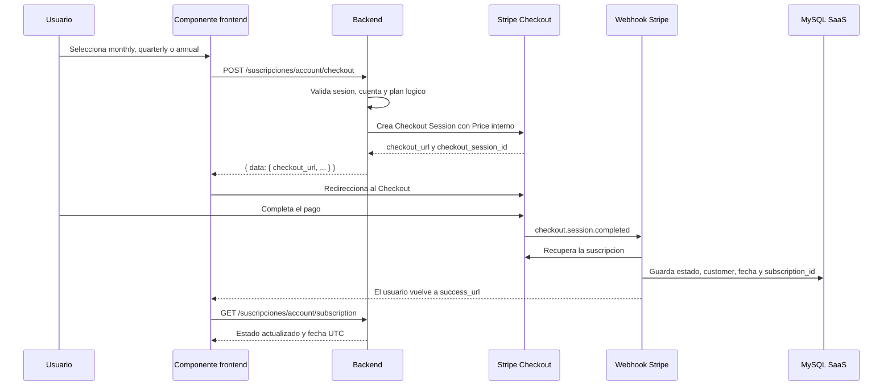

# Analisis tecnico e integracion del componente de pago de suscripciones

## 1. Objetivo

Integrar un componente frontend para contratar una suscripcion SaaS mediante Stripe Checkout, usando el flujo backend existente y tres ciclos de cobro:

| Opcion frontend | Ciclo Stripe | Descuento |
| --- | --- | --- |
| `monthly` | Mensual | Sin descuento especial |
| `quarterly` | Cada 3 meses | Precio trimestral configurado en Stripe |
| `annual` | Anual | Descuento especial incorporado en el Price anual de Stripe |

El navegador no calcula precios, impuestos, descuentos ni fechas de caducidad. Stripe define el importe recurrente y el backend sincroniza la vigencia real mediante webhook.

## 2. Flujo completo



El `success_url` solo confirma que el usuario regreso de Checkout. No debe activar acceso por si mismo. El acceso se habilita cuando el webhook confirma la suscripcion en la base de datos.

## 3. Contrato backend implementado

### Inicio de Checkout

```http
POST /suscripciones/account/checkout
Cookie: connect.sid=...
Idempotency-Key: checkout-uuid-estable
Content-Type: application/json
```

Body permitido:

```json
{
  "plan_id": "annual"
}
```

Valores validos:

- `monthly`
- `quarterly`
- `annual`

No enviar desde frontend:

- `amount`
- `currency`
- `discount`
- `stripe_price_id`
- `account_id`
- `status`
- `current_period_end`
- `external_customer_id`
- `entitlements`

Respuesta exitosa:

```http
201 Created
```

```json
{
  "data": {
    "checkout_url": "https://checkout.stripe.com/c/pay/cs_test_...",
    "checkout_session_id": "cs_test_...",
    "plan_id": "annual"
  }
}
```

La cuenta se obtiene desde `req.session.user.id`. Si el usuario no tiene cuenta SaaS, el backend la crea o reutiliza antes de abrir Checkout.

### Consulta posterior

```http
GET /suscripciones/account/subscription
```

La respuesta continua usando el contrato actual:

```json
{
  "data": {
    "account_id": 25,
    "status": "active",
    "plan": {
      "id": "legacy",
      "name": "Legacy"
    },
    "current_period_end": "2026-10-04T04:15:00.000Z",
    "cancel_at_period_end": false,
    "access_allowed": true,
    "entitlements": {
      "ct": true
    },
    "limits": {}
  }
}
```

La fecha debe tratarse como instante UTC. El frontend no debe quitar la `Z` ni volver a aplicar manualmente un margen horario.

## 4. Configuracion backend

Agregar al entorno del backend:

```env
STRIPE_SECRET_KEY=sk_test_...
STRIPE_SUBSCRIPTION_PRICE_MONTHLY=price_...
STRIPE_SUBSCRIPTION_PRICE_QUARTERLY=price_...
STRIPE_SUBSCRIPTION_PRICE_ANNUAL=price_...
STRIPE_SUBSCRIPTION_WEBHOOK_SECRET=whsec_...
FRONTEND_URL=https://frontend.example.com
STRIPE_SUBSCRIPTION_SUCCESS_URL=https://frontend.example.com/suscripciones?checkout=success
STRIPE_SUBSCRIPTION_CANCEL_URL=https://frontend.example.com/suscripciones?checkout=cancelled
```

### Configuracion en Stripe Dashboard

1. Crear un producto SaaS.
2. Crear un Price recurrente mensual: `interval=month`, `interval_count=1`.
3. Crear un Price recurrente trimestral: `interval=month`, `interval_count=3`.
4. Crear un Price recurrente anual: `interval=year`.
5. Aplicar el descuento anual directamente en el importe del Price anual o mediante una estrategia de descuento aprobada por negocio.
6. Copiar los tres `price_...` al entorno del backend.
7. Crear un endpoint de webhook apuntando a:

```text
POST https://backend.example.com/stripe/subscriptions/webhook
```

Eventos necesarios:

- `checkout.session.completed`
- `customer.subscription.created`
- `customer.subscription.updated`
- `customer.subscription.deleted`

## 5. Implementacion frontend de referencia

El componente debe generar una clave estable por intento logico. Si una peticion falla por timeout, repetirla con la misma clave; no generar otra para el mismo intento.

```vue
<script setup>
import { ref } from 'vue';

const loadingPlan = ref(null);
const errorCode = ref(null);

const plans = [
  { id: 'monthly', name: 'Mensual', description: 'Cobro recurrente cada mes' },
  { id: 'quarterly', name: 'Trimestral', description: 'Cobro recurrente cada 3 meses' },
  { id: 'annual', name: 'Anual', description: 'Precio anual con descuento especial' }
];

function getAttemptKey(planId) {
  const storageKey = `subscription-checkout-attempt:${planId}`;
  let key = sessionStorage.getItem(storageKey);
  if (!key) {
    key = crypto.randomUUID();
    sessionStorage.setItem(storageKey, key);
  }
  return key;
}

async function startCheckout(planId) {
  loadingPlan.value = planId;
  errorCode.value = null;

  try {
    const response = await fetch('/suscripciones/account/checkout', {
      method: 'POST',
      credentials: 'include',
      headers: {
        'Content-Type': 'application/json',
        'Idempotency-Key': getAttemptKey(planId)
      },
      body: JSON.stringify({ plan_id: planId })
    });

    const payload = await response.json();
    if (!response.ok) {
      errorCode.value = payload.error?.code || 'CHECKOUT_FAILED';
      return;
    }

    window.location.assign(payload.data.checkout_url);
  } catch {
    errorCode.value = 'NETWORK_ERROR';
  } finally {
    loadingPlan.value = null;
  }
}
</script>

<template>
  <section aria-labelledby="subscription-title">
    <h2 id="subscription-title">Elige tu suscripcion</h2>

    <div v-for="plan in plans" :key="plan.id">
      <h3>{{ plan.name }}</h3>
      <p>{{ plan.description }}</p>
      <button
        type="button"
        :disabled="loadingPlan !== null"
        @click="startCheckout(plan.id)"
      >
        {{ loadingPlan === plan.id ? 'Redirigiendo...' : 'Contratar' }}
      </button>
    </div>

    <p v-if="errorCode" role="alert">No fue posible iniciar el pago: {{ errorCode }}</p>
  </section>
</template>
```

El componente debe consultar `GET /suscripciones/account/subscription` cuando:

- se monta la vista;
- vuelve desde `success_url`;
- recibe `checkout=success` en la URL;
- el usuario pulsa actualizar estado.

Para evitar mostrar estado anterior inmediatamente después del pago, puede llamar una vez a:

```http
POST /suscripciones/account/subscription/refresh
```

El refresh no sustituye al webhook; solo invalida la cache y vuelve a leer MySQL.

## 6. Estados de interfaz

| Estado | Comportamiento |
| --- | --- |
| `loading` | Deshabilitar los tres botones y mostrar progreso solo en el plan elegido. |
| `201` | Redirigir inmediatamente usando `data.checkout_url`. |
| `400 IDEMPOTENCY_KEY_REQUIRED` | Generar/conservar una clave valida y reintentar el mismo intento. |
| `401 UNAUTHORIZED` | Solicitar inicio de sesion. |
| `404 ACCOUNT_NOT_FOUND` | Mostrar que no se pudo preparar la cuenta. |
| `422 INVALID_SUBSCRIPTION_PLAN` | Revisar que el plan sea uno de los tres valores permitidos. |
| `503 STRIPE_UNAVAILABLE` | Mostrar indisponibilidad temporal sin marcar la suscripcion como pagada. |
| Error de red | Conservar la misma `Idempotency-Key` para reintentar. |
| `checkout=cancelled` | Volver a la vista sin cambiar el estado de suscripcion. |
| `checkout=success` | Consultar el estado; no asumir que el webhook ya fue procesado. |

## 7. Reglas de seguridad

- El backend selecciona el Price Stripe mediante variables de entorno.
- El frontend solo puede seleccionar una clave logica de plan.
- La identidad de cuenta deriva de la sesion autenticada.
- No aceptar `account_id`, precios o metadata de billing desde el navegador.
- No registrar en logs `STRIPE_SECRET_KEY`, cookies, client secrets ni payloads completos de Stripe.
- Verificar `Stripe-Signature` usando el body crudo.
- El webhook debe devolver error si no puede persistir la suscripcion; no debe responder exito antes del commit.
- El acceso se decide por `status`, fecha vigente y entitlements, nunca por `plan_id` ni por `checkout=success`.

## 8. Sincronizacion del webhook

El backend actual implementa `suscripciones/subscription.stripe.webhook.js` y monta el endpoint antes de `express.json` en `index.js`.

Para una suscripcion Stripe se sincronizan:

- `external_customer_id` desde `subscription.customer`;
- `external_subscription_id` desde `subscription.id`;
- `status` mediante el mapa Stripe -> SaaS;
- `current_period_end` desde el timestamp Unix de Stripe;
- `cancel_at_period_end`;
- `canceled_at`;
- auditoria e invalidacion de Redis.

La fecha se transforma así:

```text
Stripe Unix timestamp
-> Date(timestamp * 1000)
-> UTC DATETIME
-> ISO 8601 con Z en la respuesta
```

## 9. Pruebas de integracion requeridas

### Checkout

- Rechazar ausencia de `STRIPE_SECRET_KEY` con `503`.
- Rechazar `plan_id` desconocido con `422`.
- Rechazar ausencia o longitud invalida de `Idempotency-Key`.
- Crear una sesion mensual con el Price mensual configurado.
- Crear una sesion trimestral con el Price trimestral configurado.
- Crear una sesion anual con el Price anual configurado.
- Verificar que el body del frontend no puede cambiar precio, moneda o Price.
- Verificar que dos reintentos con la misma clave no crean dos sesiones Stripe.

### Webhook

- Rechazar firma invalida con `400`.
- Procesar `checkout.session.completed`.
- Procesar cambio de suscripcion activa a `past_due`.
- Procesar cancelacion al finalizar el periodo.
- Procesar `customer.subscription.deleted`.
- Verificar que `2026-09-04T04:15:00.000Z` se devuelve sin desfase.
- Verificar que `cancel_at_period_end=false` se guarda como `0` y vuelve como `false`.
- Verificar invalidacion de `saas:entitlements:account:{accountId}:v1`.

## 10. Pendientes antes de produccion

1. Configurar los tres Prices reales y el descuento anual en Stripe.
2. Configurar `STRIPE_SUBSCRIPTION_WEBHOOK_SECRET` en el servidor.
3. Registrar el endpoint de webhook en Stripe.
4. Añadir deduplicacion persistente por `event.id` para evitar auditorias repetidas y reprocesamientos.
5. Añadir pruebas de rutas con Stripe mockeado.
6. Verificar que la columna `current_period_end` sea `DATETIME` o `TIMESTAMP`, nunca `DATE`.
7. Definir si el Price trimestral representa un cobro único de 3 meses o una suscripcion recurrente cada 3 meses; el contrato actual implementa la segunda opcion.
8. Probar el retorno de Checkout en navegador real con cookies de sesion y `credentials: include`.

## 11. Archivos backend relacionados

- `suscripciones/subscription.routes.js`: endpoint de Checkout y rutas existentes.
- `suscripciones/subscription.stripe.webhook.js`: firma y sincronizacion de eventos.
- `suscripciones/subscription.service.js`: proyeccion, cache y reglas de acceso.
- `suscripciones/repository/subscription.repository.js`: persistencia MySQL.
- `suscripciones/subscription.dto.js`: contrato JSON para frontend.
- `ct/config/db_ct.js`: pool MySQL en UTC.
- `index.js`: montaje del webhook antes del parser JSON.
