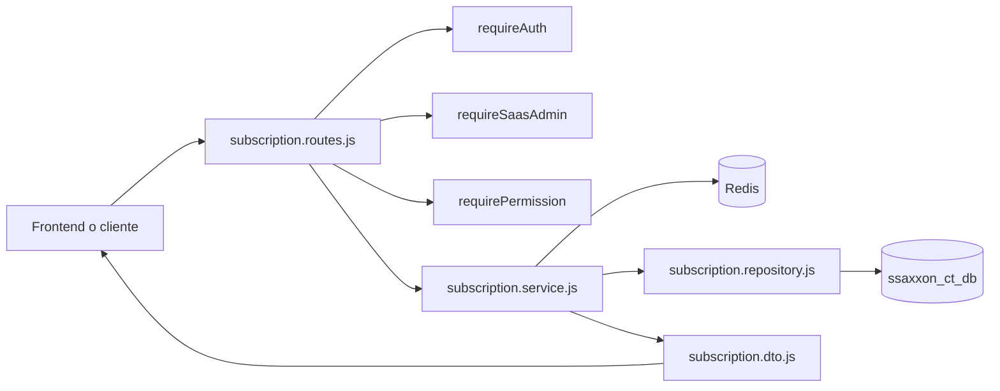
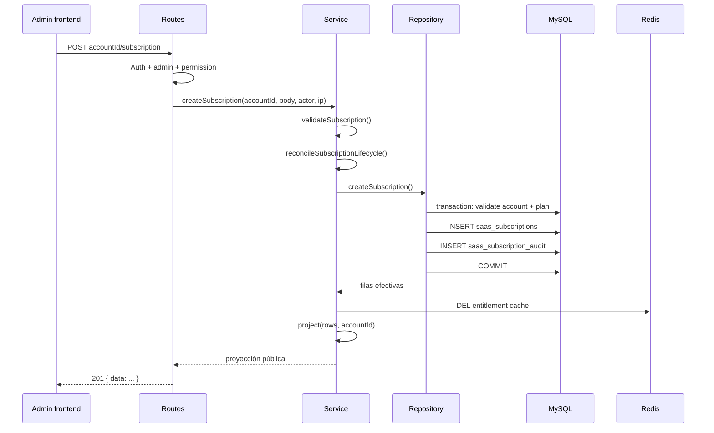

# Análisis del flujo completo de suscripciones SaaS

## 1. Punto de entrada y arquitectura

El router se define en [suscripciones/subscription.routes.js](suscripciones/subscription.routes.js) y se publica desde [index.js](index.js) con:

```text
app.use('/suscripciones', subscriptionRoutes)
```

Por lo tanto, las rutas efectivas comienzan con `/suscripciones`. El router no contiene la lógica de negocio ni ejecuta SQL directamente. Su responsabilidad es:

1. validar que exista una sesión;
2. comprobar el acceso administrativo cuando corresponde;
3. recoger parámetros, body, usuario e IP;
4. delegar en `subscription.service.js`;
5. convertir la respuesta al contrato HTTP;
6. entregar los errores al manejador global mediante `next(error)`.

La composición de dependencias es:



El servicio se crea una sola vez al cargar el módulo con `poolCT` y un adaptador Redis. La base de datos es la fuente de verdad; Redis sólo conserva proyecciones temporales de entitlements.

## 2. Modelo de datos

La migración [setup/sql/005_saas_subscriptions.sql](setup/sql/005_saas_subscriptions.sql) define las entidades principales:

| Tabla | Responsabilidad |
| --- | --- |
| `saas_accounts` | Empresa o unidad comercial y de cobro. |
| `saas_account_users` | Relación entre una cuenta y sus usuarios. |
| `saas_plans` | Catálogo de planes, con estados `draft`, `active` y `archived`. |
| `saas_plan_entitlements` | Funcionalidades y límites incluidos en cada plan. |
| `saas_subscriptions` | Contratación histórica/actual de un plan por cuenta. |
| `saas_account_entitlement_overrides` | Excepciones de acceso específicas de una cuenta, con posible expiración. |
| `saas_subscription_audit` | Registro de acciones administrativas, motivo, actor e IP. |

La migración [setup/sql/006_saas_account_providers.sql](setup/sql/006_saas_account_providers.sql) agrega `saas_account_providers`. Una cuenta puede agrupar usuarios y proveedores, pero `proveedor_id` no crea una suscripción independiente: limita el alcance operativo de una cuenta ya resuelta.

La relación conceptual es:

```text
saas_accounts
  -> saas_account_users -> user
  -> saas_account_providers -> proveedores
  -> saas_subscriptions -> saas_plans -> saas_plan_entitlements
  -> saas_account_entitlement_overrides
```

## 3. Rutas de cuenta para el usuario autenticado

Estas rutas no aceptan `account_id` desde el navegador. El servicio obtiene la cuenta mediante `saas_account_users` usando `req.session.user.id`.

| Método | Ruta efectiva | Comportamiento |
| --- | --- | --- |
| `GET` | `/suscripciones/account/subscription` | Devuelve la proyección efectiva de la cuenta del usuario. |
| `GET` | `/suscripciones/account/providers/:proveedorId/subscriptions` | Lista suscripciones de la cuenta relacionada con el usuario y el proveedor indicado. |
| `POST` | `/suscripciones/account/subscription/refresh` | Invalida Redis y reconstruye la proyección desde MySQL. |
| `POST` | `/suscripciones/account/subscription` | Alta inicial: crea o reutiliza la cuenta del usuario y crea su suscripción. |
| `POST` | `/suscripciones/account/checkout` | Crea una sesión Stripe Checkout para `monthly`, `quarterly` o `annual`; requiere `Idempotency-Key`. |

El usuario no puede cambiar o cancelar su suscripción desde estas rutas. Las rutas de consulta devuelven una proyección vacía con estado `expired` y sin entitlements cuando todavía no existe relación con una cuenta.

El checkout no recibe precios ni importes desde el navegador. El backend resuelve `STRIPE_SUBSCRIPTION_PRICE_MONTHLY`, `STRIPE_SUBSCRIPTION_PRICE_QUARTERLY` o `STRIPE_SUBSCRIPTION_PRICE_ANNUAL`; el descuento anual debe estar incorporado en el Price anual de Stripe. Tras el pago, `POST /stripe/subscriptions/webhook` sincroniza la suscripción y sus fechas en UTC.

La excepción es `POST /suscripciones/account/subscription`, destinada al primer alta autenticada. El backend obtiene `userId` y `proveedor_id` de la sesión, por lo que el frontend no debe intentar resolver ni enviar un `account_id`. Puede enviar `plan_id`, `status` y los datos opcionales de vigencia o billing. La respuesta es `201 { data: ... }`.

## 4. Creación de una suscripción

La ruta administrativa de alta es:

```text
POST /suscripciones/admin/saas/accounts/:accountId/subscription
```

Requiere, en este orden:

1. `requireAuth`: sesión con `req.session.user.id`.
2. `requireSaasAdmin`: `rol === 'admin'` o `isAdminUser === true`.
3. `requirePermission('saas.subscription.create')`: permiso explícito, permiso por rol o compatibilidad temporal para administradores legacy.

El body mínimo es:

```json
{
  "plan_id": "enterprise",
  "status": "active"
}
```

También puede incluir `proveedor_id`, `started_at`, `current_period_end`, `cancel_at_period_end`, `external_customer_id`, `external_subscription_id` y `reason`.

La secuencia interna es:



`validateSubscription` exige un `plan_id` string y un estado dentro de `active`, `trialing`, `past_due`, `canceled`, `expired` o `suspended`. Después, el repositorio concreto vuelve a validar que la cuenta esté activa y que el código del plan exista y esté activo.

La operación SQL de creación es transaccional. Si falla la cuenta, el plan, el INSERT o la auditoría, se hace rollback y no se debe considerar creada la suscripción.

### Provisión previa: capacidad frente a implementación real

El servicio intenta ejecutar, si existen, estos métodos del repositorio:

- `ensureAccountForSubscription`;
- `ensureProviderForAccount`;
- `ensurePlanEntitlements`;
- `reconcileAccountEntitlements`.

Esto expresa la intención de dejar preparada la cuenta, la relación de proveedor y los entitlements antes del alta. Sin embargo, esos métodos no aparecen en la implementación concreta actual de [suscripciones/repository/subscription.repository.js](suscripciones/repository/subscription.repository.js). Como las llamadas están protegidas por `typeof ... === 'function'`, la creación continúa sin esa provisión cuando se usa el repositorio MySQL actual. Las pruebas inyectan un repositorio simulado que sí los implementa, por lo que prueban la capacidad del servicio, no la disponibilidad de esa capacidad en producción.

## 5. Cómo se calcula el acceso efectivo

`findEffectiveSubscription(accountId)` busca la suscripción activa más reciente de la cuenta. Sólo considera estados `active` y `trialing`, y además exige que el plan siga en estado `active`.

La consulta combina:

1. la suscripción seleccionada;
2. el plan contratado;
3. los entitlements del plan;
4. los overrides de la cuenta que no hayan expirado.

`project()` devuelve:

```json
{
  "account_id": 25,
  "status": "active",
  "plan": { "id": "enterprise", "name": "Enterprise" },
  "current_period_end": "2026-10-01T00:00:00.000Z",
  "cancel_at_period_end": false,
  "entitlements": { "ct": true },
  "limits": { "providers": 20 }
}
```

Un override, si existe y no expiró, reemplaza el valor `enabled` del plan para la misma `feature_key`. Los límites se agregan desde `limits_json` de los entitlements habilitados.

Si el estado no es `active` ni `trialing`, la proyección conserva el estado informativo, pero devuelve `entitlements: {}` y `limits: {}`. Por ello `past_due`, `canceled`, `expired` y `suspended` no conceden acceso.

## 6. Caché y refresco

La clave utilizada es:

```text
saas:entitlements:account:{accountId}:v1
```

La lectura intenta Redis primero. Si Redis falla o no contiene la clave, se consulta MySQL y se guarda la proyección durante 120 segundos. Los fallos de Redis se registran y no autorizan por sí mismos ningún acceso.

Las operaciones de alta, actualización, cancelación, override y refresh invalidan la clave. El refresh elimina primero la clave y luego vuelve a consultar y guardar la proyección. Esto permite que un cambio administrativo sea visible sin esperar al TTL.

## 7. Operaciones administrativas

Todas las rutas siguientes exigen sesión, acceso SaaS administrativo y permiso granular:

| Método | Ruta | Permiso | Resultado |
| --- | --- | --- | --- |
| `GET` | `/admin/saas/accounts/:accountId/subscription` | `saas.subscription.read` | Proyección de una cuenta. |
| `GET` | `/admin/saas/subscriptions` | `saas.subscription.read` | Listado filtrable por cuenta, proveedor y estado. |
| `GET` | `/admin/saas/users/:userId/subscriptions` | `saas.subscription.read` | Suscripciones de las cuentas relacionadas con un usuario. |
| `GET` | `/admin/saas/subscriptions/:subscriptionId` | `saas.subscription.read` | Detalle de una fila de suscripción. |
| `POST` | `/admin/saas/users/:userId/account` | `saas.account.create` | Crea o resuelve la cuenta de un usuario y devuelve `201`. |
| `POST` | `/admin/saas/accounts/:accountId/subscription` | `saas.subscription.create` | Crea una suscripción y devuelve `201`. |
| `PUT` | `/admin/saas/accounts/:accountId/subscription` | `saas.subscription.update` | Actualiza la suscripción más reciente de la cuenta. |
| `PUT` | `/admin/saas/subscriptions/:subscriptionId` | `saas.subscription.update` | Actualiza una suscripción por ID. |
| `DELETE` | `/admin/saas/subscriptions/:subscriptionId` | `saas.subscription.cancel` | Cancelación lógica, no elimina la fila. |
| `PATCH` | `/admin/saas/accounts/:accountId/entitlements/:featureKey` | `saas.entitlement.update` | Crea o actualiza un override de cuenta. |

Los cambios de suscripción y overrides usan transacciones y escriben auditoría con actor, razón, payload posterior e IP. La cancelación establece `status = 'canceled'`, `canceled_at` y `cancel_at_period_end = 1`.

## 8. Administración de planes

El mismo router sí expone CRUD administrativo para el catálogo:

- `GET /admin/saas/plans` con filtros `estado`, `codigo` y `activo`;
- `GET /admin/saas/plans/:planId`;
- `POST /admin/saas/plans`;
- `PUT /admin/saas/plans/:planId`;
- `DELETE /admin/saas/plans/:planId`.

Los permisos son `saas.plan.read`, `saas.plan.create`, `saas.plan.update` y `saas.plan.delete`. El delete es lógico: cambia el plan a `archived`. No existen actualmente rutas en `subscription.routes.js` para administrar directamente los registros de `saas_plan_entitlements`; tampoco se observa una ruta pública de creación de cuentas o de relaciones cuenta-proveedor en este router.

## 9. Provisión administrativa de cuentas

En la vista de administración, es necesario crear o resolver la cuenta SaaS de un usuario antes de poder asignarle una suscripción. Para esto se expone:

```text
POST /suscripciones/admin/saas/users/:userId/account
```

Requiere:
- `requireAuth`: sesión con `req.session.user.id`
- `requireSaasAdmin`: `rol === 'admin'` o `isAdminUser === true`
- `requirePermission('saas.account.create')`: permiso explícito

Body opcional:
```json
{
  "account_name": "Nombre de la cuenta",
  "proveedor_id": "cod_proveedor_opcional"
}
```

Comportamiento:
1. Si el usuario ya tiene una cuenta activa, la devuelve.
2. Si no existe, crea una nueva con el nombre proporcionado (o `Cuenta {userId}`).
3. Si se proporciona `proveedor_id`, lo relaciona con la cuenta.
4. Registra auditoría de creación si es nueva.
5. Devuelve `201 { data: { id, nombre, estado } }`.

La respuesta contiene el `account_id` necesario para luego crear la suscripción con:
```text
POST /suscripciones/admin/saas/accounts/:accountId/subscription
```

## 10. Enforcement en módulos de negocio

La lectura de una suscripción no bloquea por sí sola todos los módulos. El enforcement se compone con [suscripciones/subscription.middleware.js](suscripciones/subscription.middleware.js):

```text
requireAuth -> resolveAccount -> requireEntitlement('feature')
```

`resolveAccount` obtiene la cuenta desde la sesión y puede validar que el `proveedor_id` pertenezca a `saas_account_providers`. `requireEntitlement` consulta la proyección efectiva y devuelve `403 SUBSCRIPTION_REQUIRED` si la funcionalidad no está habilitada.

En CT existe una ruta piloto que usa este patrón. Las rutas legacy y B2B que no incorporan `requireEntitlement` no quedan protegidas automáticamente por el router de suscripciones.

## 10. Contratos y errores

Las respuestas de detalle usan `{ "data": ... }`; los listados usan `{ "data": [...] }`. Las rutas de cuenta ignoran un `account_id` enviado por el cliente y derivan el alcance de la sesión.

Errores previstos:

- `401 UNAUTHORIZED`: falta sesión;
- `403 PERMISSION_DENIED`: falta rol o permiso administrativo;
- `403 PROVIDER_OUTSIDE_ACCOUNT`: proveedor fuera de la cuenta SaaS;
- `403 SUBSCRIPTION_REQUIRED`: entitlement ausente;
- `404 ACCOUNT_NOT_FOUND`, `PLAN_NOT_FOUND` o `SUBSCRIPTION_NOT_FOUND`;
- `422 INVALID_PLAN`, `INVALID_PLAN_PAYLOAD` o `INVALID_SUBSCRIPTION_STATUS`;
- `503 SUBSCRIPTION_UNAVAILABLE`: no fue posible resolver la cuenta.

El frontend debe usar `status`, `entitlements`, `limits` y `current_period_end`; no debe decidir acceso únicamente por el código del plan.

## 11. Flujo de provisión completo desde frontend administrativo

El flujo recomendado para crear una suscripción a un usuario desde el admin es:

1. **Crear o resolver la cuenta:**
   ```
   POST /suscripciones/admin/saas/users/{userId}/account
   { "account_name": "...", "proveedor_id": "..." }
   └─ Respuesta: { data: { id: 25, nombre: "...", estado: "active" } }
   ```

2. **Crear la suscripción:**
   ```
   POST /suscripciones/admin/saas/accounts/{accountId}/subscription
   { "plan_id": "enterprise", "status": "active" }
   └─ Respuesta: { data: { account_id: 25, status: "active", plan: {...}, entitlements: {...} } }
   ```

Esta secuencia evita:
- Crear accidentalmente la cuenta del administrador autenticado (si se usara `/account/subscription`).
- Requerir que el `accountId` ya exista en la base de datos.
- Mantener la auditoría correcta de quién realizó cada acción.

## 12. Riesgos y pendientes detectados

1. **Provisión automática incompleta en el repositorio real.** El servicio permite hooks de reconciliación, pero el repositorio MySQL actual no los implementa.
2. **Entitlements de plan sin API propia.** Se pueden leer al calcular el acceso, pero no hay rutas CRUD para gestionarlos desde el frontend administrativo.
3. **Enforcement parcial.** Sólo los módulos que agregan explícitamente `resolveAccount` y `requireEntitlement` aplican la suscripción.
4. **Renovación no publicada en el router.** El servicio tiene `renewSubscription`, pero `subscription.routes.js` no expone una ruta específica de renovación.
5. **Billing/webhooks fuera del flujo actual.** Los identificadores externos se almacenan, pero no existe en este módulo un webhook firmado e idempotente que actualice estados automáticamente.
6. **Auditoría sin snapshot anterior completo en las actualizaciones actuales.** Se registra principalmente `after_json`; si se requiere trazabilidad completa, conviene persistir también el estado anterior.

## 12. Verificación existente

Las pruebas de [suscripciones/subscription.service.test.js](suscripciones/subscription.service.test.js) cubren la proyección activa, estados que no otorgan acceso, invalidación de caché, refresh, cancelación, permisos y mocks de provisión durante el alta. No sustituyen una prueba de integración contra MySQL, Redis y el router Express real; esa sería necesaria para confirmar las transacciones, constraints, montaje de rutas y comportamiento de los métodos opcionales del repositorio.